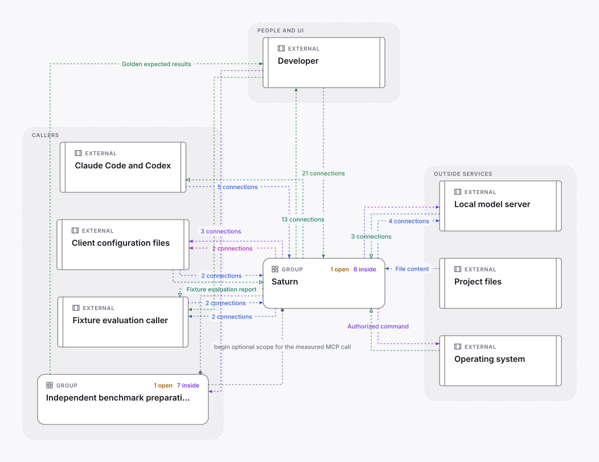
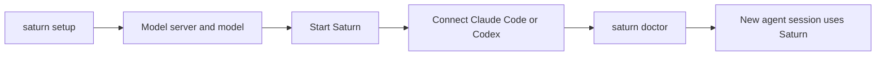

# Architecture

The [architecture model](architecture/index.html) describes the implemented system. It opens from the agreed system boundary to containers, components, and detailed decisions.

<picture>
  <source media="(prefers-color-scheme: dark)" srcset="images/architecture-dark.svg">
  
</picture>

| View | Shows |
|---|---|
| Structure | Responsibilities, conditions, limits, and source locations at each level |
| Journeys | Complete calls, owner actions, timers, refusals, and failure paths |
| Data | Record fields, transformations, and the stores that keep each record |

Start with a [command call](architecture/index.html#journey:command_inline), [workspace authorization](architecture/index.html#in:saturn.service.ingress.workspace), or the [stored run record](architecture/index.html#data:run).

| Process or store | Responsibility | Owns |
|---|---|---|
| Saturn HTTP service | Tools, policy, digests, research, administration, and telemetry | The store and the model lifecycle |
| Client-launched commands | `saturn stdio` forwards one client's MCP calls; the hook relay forwards its shell hook events | Nothing; each call opens a fresh connection |
| Command line | Setup, client connection, configuration, and observability | Invokes shared application operations in the CLI process; opens the same store |
| Dashboard | Show service data and change local controls | Browser appearance preferences |
| Saturn home folder | `.env`, `settings.toml`, `policy.toml`, credential files, install records, backups, data | Configuration and secrets, outside any checkout |
| Client configuration files | Saturn's entries in Claude Code's and Codex's own files | Written only by the connection service, after confirmation |
| Model server | Answer constrained Responses API calls | Model execution and loaded instances |

## Service layers

| Layer | Responsibility | Allowed dependencies |
|---|---|---|
| Domain | Policy and command grammar, text operations, digests, records | Standard library |
| Application | Use cases, live configuration, workspace selection, access and connection, ports, recording | Domain, Pydantic, LangGraph |
| Infrastructure | Files, processes, SQLite, configuration files, credential files, client configuration writers, model servers | Domain and application contracts |
| Transport | MCP, JSON API, hooks, and stdio translation | Application and the composition container |
| Bootstrap | Startup settings, composition, command line, hook relay, managed lifecycle | All inner layers |

A layer test enforces the direction. The hook relay imports only the standard library, so the delay it adds to each shell command stays small.

## Configuration on use

Settings and policy are files in the Saturn home folder. The service checks their modification time at the start of each tool call, hook call, and settings or policy request, and re-reads a changed file. A valid change applies at once and is written to the audit log with a summary; an invalid file is not applied, the last good version stays in force, and the error is shown in the dashboard and by `saturn doctor`. No restart and no file watcher are needed.

## Data and lifetime

| Data | Owner | Lifetime |
|---|---|---|
| Runs, spans, model calls (with previews) | Telemetry repository | No automatic retention |
| Full request, response, model prompt, and model reply bodies | Telemetry repository | 48 hours; evicted on start and insertion |
| Artifacts | Artifact repository | 48 hours by default; evicted on start and insertion, and above the size budget |
| Harnesses and token hashes | Access store | Until the data folder is replaced |
| Audit events | Access store | No automatic retention |
| Settings and policy | `settings.toml`, `policy.toml` | Until changed |
| Tokens for local clients | Credential files | Until rotation or revocation |
| Client installs and backups | `installs.json`, `backups/` | Until disconnect; backups are kept |
| Appearance | Browser | Per-browser storage |

One locked SQLite connection uses WAL. The schema version starts at 100; a store from an earlier, incompatible layout is refused with a message rather than read.

## Runtime

- Windows background control verifies process identity and uses a run-specific stop marker; start, stop, and status work from any folder.
- Startup marks orphaned runs as interrupted and records a service start; shutdown records a stop, drains HTTP for the grace period, cancels unfinished requests, and unloads any model Saturn loaded.
- Command cancellation terminates the owned subprocess tree.
- Command-line tools open the store without the service's start-up bookkeeping, so they are safe to run while the service is running.

## User flows

The [architecture model](architecture/index.html) contains the request flows: first-time setup, connecting a client, a run and its digest, a refusal by policy, a hand-edited policy, stdio forwarding, shell hooks, and the dashboard reads.

### First run

The dashboard follows the same order: Overview shows a checklist (choose a model, create a harness, install it in a client) until all three are done, each step linked to where it happens.

### Connecting a client from the dashboard

1. Connections → Create harness: name, handle (suggested from the name, fixed once created), tools, and optional limits.
2. The token dialog says where the token was saved; copy it only for an HTTP client.
3. Install in a client: choose Claude Code or Codex, a permission preset, and hooks.
4. Preview changes lists each file and what changes; Install writes them after a backup.
5. Start a new session (Claude Code) or restart Codex.

Remove from a client takes Saturn's entries out again. The same dialog shows the terminal command and a by-hand version with no token in it.

### Navigation

| Page | Task | Deep link |
|---|---|---|
| Overview | Finish setup; see savings and failures for a period | `#/` |
| Runs | Filter by outcome, tool, harness, or text; inspect a trace | `#/runs`, `#/runs/<id>`, `#/runs?harness=<id>` |
| Changes | Read the audit log by kind | `#/changes` |
| Artifacts | Read stored output by page | `#/artifacts`, `#/artifacts/<id>` |
| Model | Model server status and model use | `#/model` |
| Connections | Harnesses, their limits, and their clients | `#/connections` |
| Settings | Model and limits; commands and folders; appearance | `#/settings/model`, `#/settings/commands`, `#/settings/appearance` |

Labelled desktop navigation becomes a bottom tab bar on narrow screens. Filters live in the link; appearance stays in the browser.

### Tracing one request

A run's trace in Runs reads top to bottom: the request (how it arrived, from which client, every argument), the path of steps with times (authentication, workspace, policy rule, command, digest, model calls), each model call's prompt and reply (Show full loads the complete text), and the exact response. Refused requests appear in the same list with the reason. Full bodies are kept 48 hours; after that the trace says so and keeps the previews.

### Changing access

| Action | Result |
|---|---|
| Edit | Name, tools, folders, denied commands, hooks, expiry |
| Disable / Enable | Pause or restore access, subject to expiry |
| Rotate | Replace the token at once; local clients pick up the new token file |
| Revoke | Permanently refuse access and delete the token file |

Rotation and revocation require typing the action's name. Unsaved forms ask before they are discarded. Every change appears under Changes with who made it.

### Commands and folders

Settings → Commands and folders shows the effective rules with their source and answers "would this run?" for a command, a folder, and optionally a harness, without running anything. Rules change through `policy.toml` or `saturn policy`, which asks for confirmation before widening.

### Feedback and recovery

| Condition | Behavior |
|---|---|
| First fetch | Skeleton; an error offers Retry |
| Refresh failure | Keep the last data and mark it stale |
| Hidden page | Pause polling; refresh on return |
| No model selected | Code digests; the sidebar says so without warning |
| Model selected but unreachable | Code digests; the sidebar warns |
| Command refused | The agent gets the rule and how to ask the owner; the run records the refusal |
| Settings or policy file invalid | Not applied; the last good version stays; Settings and `saturn doctor` show the error |
| Client configuration file unreadable | Install refuses and changes nothing |
| Hook cannot reach Saturn | The shell command runs as usual |

Charts compare real sampled values on shared axes, with legends, keyboard inspection, and table alternatives. Reduced-motion preferences turn off entrance and value-transition effects.
